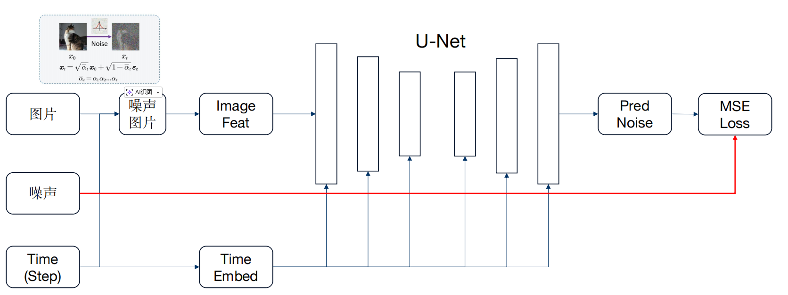

#  深度学习 Deep Learning
## 神经网络 Neural Network
###  Pytorch 和 TensorFlow

* Pytorch Tensor
* 文字处理的常见通道排序：`[B, C, L]`
  * batchsize(B)：一批文字的数量
  * channel(C)：文字的通道数
  * long(L)：文字经历分词后的token数量
* 图像处理的常见通道排序：`[B, C, H, W]`
  * batchsize(B)：一批图像的数量
  * channel(C)：图像的深度（RGB图像有3个通道深度）
  * height(H)：图像的高度
  * width(W)：图像的宽度 

### 数据维度排列
* 线性层（MLP）维度排列：`[..., Channel1]`，期望通道在最后一维。
* 卷积层（CNN）维度排列：`[Batch, Channel, Height, Width]`，期望通道在第二维。
因此，在卷积层和线性层之间切换时，需要使用`torch.flatten`将卷积层的输出展平为线性层期望的维度排列，或者使用`torch.permute`调整维度顺序。
* 卷积层->线性层：`[B, C, H, W] -> [B, H, W, C]`;卷积层->线性层：`[B, H, W, C] -> [B, C, H, W]`

### 神经网络模型搭建
1. 前方反馈网络

~~神经网络中信息单向流动，从输入层经过隐藏层到输出层，没有反馈连接。~~

2. 误差反向传播

由输出层误差推前一层误差，~~将复杂的求导过程通过拉格朗日多项式化为简单的减法过程~~。  

在残差网络ResNet发明之前，存在梯度爆炸和梯度消失。这是因为在计算过程中，由于误差反向传播后会乘后一层误差，当神经网络层数较大时，其误差也会成指数型增大或减少。

### 全连接层
主要目的：对图像特征提取后的特征进行分类

### BN层（BatchNorm）批量归一化处理
需对数据做归一化处理，使其分布一致。在深度神经网络训练过程中，通常一次训练是一个batch，而非全体数据。每个batch具有不同的分布产生了internal covarivate shift问题——在训练过程中，数据分布会发生变化，对下一层网络的学习带来困难。Batch Normalization将数据规范到均值为0，方差为1的分布上，它按 batch 统计量进行标准化，并通过可学习的缩放和偏移改善优化过程。

## 训练方式
### 特征图预处理方法
训练的预处理方法，对特征图进行缩放、平移、旋转、翻转等操作，得到多个多样性图片
### 优化器超参数
* 学习率(Learning Rate):控制每次参数更新的步长
* 动量 (Momentum):加速收敛并减少震荡;保留前次更新方向的部分惯性
* 权重衰减 (Weight Decay / L2正则化):防止过拟合，约束参数幅度
### 学习率衰减策略
* 热身训练:适合初期,将学习率降低再逐步恢复正常
* 阶梯衰减:适合在学习末期，在特定迭代次数，进行学习率衰减，防止模型过拟合
### 早停机制
当损失函数的loss值减少较少时，停止训练
### 恢复机制 
当出现特殊情况而停止训练后，使用恢复机制继续训练模型，继续迭代
### 训练参数[总样本数 N] → [Batch Size B] → [Iterations per Epoch = N/B] → [Epochs E]
* 样本(Sample):单个训练数据单元
* 批大小(Batch Size):每次输入模型的样本数量[Tensor的通道排序:`[Batch, Channel, Height, Width]`中的`batch`即Batch Size]
* 迭代次数(Iteration):完成一次模型参数更新所需的批次处理次数
* 训练轮次(epoch):完整遍历一次训练集的过程,小训练集多次训练能防止欠拟合

### model.train() VS model.eval() VS torch.no_grad()
* model.train():设置模型为训练模式
1. 训练模式中，BatchNorm 会计算当前批次的均值和方差，并更新运行均值（running mean）和方差（running variance）
2. 训练模式中，Dropout 会随机将部分神经元置零，以防止过拟合
* model.eval():设置模型为评价模式
1. 评价模式中，BatchNorm 使用之前累积的运行均值和方差，不再更新
2. 评价模式中，Dropout 被禁用，所有神经元都会参与计算
* torch.no_grad()
禁用梯度更新，一般使用在 *model.eval()* 阶段中。用于节省内存和计算资源。

### 模型权重
这里更推荐使用**模型参数**这个说法。因为“权重”通常特指网络中的可学习系数，而在实际使用中，大家常常会把整个模型中训练得到的参数统称为“模型权重”。对初学者来说，可以先把它理解为：**模型通过训练学到的一组数字，这组数字决定了模型看到输入后会如何输出结果。**

模型训练完成后，通常会把这些参数保存下来，方便后续直接使用，而不必每次都重新训练。保存后的模型参数可以用于：
1. 推理和预测：直接拿来做分类、检测、分割等任务。
2. 继续训练：在原有训练结果上接着优化。
3. 迁移到新任务：把已有知识作为新任务的起点。

在PyTorch中，常见做法是保存和加载模型参数：
1. 保存参数：`torch.save(model.state_dict(), 'model_weights.pth')`
2. 加载参数：`model.load_state_dict(torch.load('model_weights.pth'))`

从训练方式上看，围绕模型参数通常有以下几种常见思路：
1. 从头开始训练（Training from Scratch）：模型参数随机初始化，然后完全依靠当前任务的数据去学习。这种方式对数据量和计算资源要求较高，但如果数据足够、任务也比较特殊，效果可能更好。
2. 迁移学习（Transfer Learning）：先加载一个已经训练好的**预训练权重**，再把它用于新任务。因为模型已经在大规模数据上学到了一些通用特征，所以新任务通常收敛更快，对数据量的要求也更低。
3. 微调（Fine-tuning）：微调可以看作迁移学习的进一步深入。它不是只“加载预训练权重就直接使用”，而是加载后继续用新任务数据训练，让模型参数进一步适应当前任务。微调时可以只调整一部分参数，也可以调整整个模型，这取决于新旧任务的相似程度以及数据规模。
4. 知识蒸馏（Distillation）：这与直接复用权重不完全相同。它是让一个较小的学生模型去学习一个较大的教师模型的输出规律，从而把教师模型的知识迁移过去。这样可以在尽量保留性能的同时，减小模型体积，适合部署到移动设备或嵌入式平台。

模型计算资源指标：
1. Params：模型中可学习参数的总数量（参数规模）。
2. FLOPs（Floating Point Operations）：模型在一次前向传播中需要执行的浮点运算次数。
3. Desc. Dim.：描述子维度，特征点描述子向量的维度大小。
4. Inference Time：模型在特定硬件上进行一次前向传播所需的时间，通常以毫秒（ms）为单位。

### 模型显存
模型的显存取决于**模型精度**、**上下文长度**和**用途**。

推理显存 = 模型权重 + KV Cache + 临时计算空间 + CUDA/框架开销

在工程上可以给模型权重额外预留约10%~30%的空间存放其余内容。
#### 模型精度
以大模型10B（100亿权重参数量）为例。

| 模型精度 | 模型显存 |
| --- | --- |
| FP32推理 | 40GB |
| FP16/BF16推理 | 20GB |
| INT8推理 | 10GB |
| INT4推理 | 5GB |

以FP32推理为例，FP32每个参数对应32位，对应4字节。

计算公式：

$ 10,000,000,000 *32 /8 /1024 /1024 /1024 \approx 40GB $

#### 上下文长度
显存中还需要进行**KV Cache**用于生成文本时保存上下文，能根据KV Cache，生成下一个token，避免每一步都需要重新计算前文而产生大量重复计算，其占用随上下文长度增加。与KV Cache相关的有`batch_size`、`上下文长度`、`Transformer层数`、`KV头数量`、`每个head的维度`、`KV Cache精度`。

#### 用途
在模型进行训练时，学习并修改参数；在模型进行推理时，使用已有参数生成结果。
| | 模型训练 | 模型推理 |
| --- | --- | --- |
| 目的 | 学习知识、能力或任务 | 回答问题、生成文本 |
| 参数是否更新 | 更新 | 不更新 |
| 主要计算 | 前向传播+反向传播 | 只有前向传播 |
| 是否计算梯度 | 是 | 否 |
| 优化器 | 需要 | 不需要 |
| 显存需求 | 很高 | 相对较低 |
| 关注指标 | 训练速度、loss、收敛性 | 首字延迟、生成速度、吞吐量 |
| 常见精度 | FP16、FP32 | FP16、INT8、INT4 |
| 常见优化 | ZeRO、FSDP、梯度检查点 | 量化、KV Cache、连续批处理 |

## 多层感知机 MLP
通过在网络中加入一个或多个隐藏层来克服线性模型的限制， 使其能处理更普遍的函数关系类型。 要做到这一点，最简单的方法是将许多全连接层堆叠在一起。 每一层都输出到上面的层，直到生成最后的输出。 我们可以把前 $ L-1 $ 层看作表示，把最后一层看作线性预测器。 这种架构通常称为多层感知机（multilayer perceptron），通常缩写为MLP。

多层感知机可以通过隐藏神经元，捕捉到输入之间复杂的相互作用， 这些神经元依赖于每个输入的值。 我们可以很容易地设计隐藏节点来执行任意计算。 而且，虽然一个单隐层网络能学习任何函数， 但并不意味着我们应该尝试使用单隐藏层网络来解决所有问题。 事实上，通过使用更深（而不是更广）的网络，我们可以更容易地逼近许多函数。

多层感知机在输出层和输入层之间增加一个或多个全连接隐藏层，并通过激活函数转换隐藏层的输出。

## 深度卷积神经网络 AlexNet

## 网络中的网络 NiN

## 含并行连接的网络 GoogLeNet

## 稠密连接网络 Densenet

## 门控循环单元 GRU

## 长短期记忆网络 LSTM

## PointNet
PointNet是一个处理点云数据的神经网络架构，专门设计用于处理无序的点云数据。它通过对每个点进行独立的特征提取，并使用对称函数（如max pooling）来聚合这些特征，从而实现对整个点云的全局特征表示。PointNet在3D物体分类、分割和场景理解等任务中表现出色，成为点云处理领域的重要基石。

点云数据是无序性的，只要位置不变，任意变换顺序，数据不改变；图像数据是有序性的，图像像素具有规则网格结构和空间邻接关系，图像的像素变换位置，图像信息就变了。

PointNet的核心是MLP + Max Pooling，MLP用于编码信息，Max Pooling用于忽略顺序。

## 模仿学习
### 模仿学习简介

## 强化学习 Reinforcement Learning
[**Reinforcement Learning**](./ReinforcementLearning.md)

## 骨干神经网络 BackBone
现代模型可以在前人的基础上进行拼接得到，例如主干网络BackBone。它的作用是特征提取，从输入图像提取多层级的语义特征。
* 常用的主干网络BackBone有：`VGG-16`、`ResNet`。

### 使用块的网络 VGG 
**要点：具有相同的感受野，同样提取了大卷积核的图像特征，且计算参数少**  

在卷积神经网络中，决定某一层输出结果中一个元素所对应的输入层的区域大小，被称作感受野。通俗的解释是，输出feature map上的一个单元对应输入层上的区域大小。  

通过堆叠多个3x3的卷积核来替代大尺度卷积核（减少所需参数）,通过堆叠两个3x3的卷积核来替代5x5的卷积核，三个3x3的卷积核来替代7x7的卷积核，具有相同的感受野。  

通过设定多个卷积核，可以提取多种特征，增加模型的表达能力，增强模型的鲁棒性。  

* VGG-16(说明有16层（不包括池化层），经过2层conv后池化，2层conv后池化，3层conv后池化，3层conv后池化，3层conv后池化，最后经过3层全连接层，共16层)  

### 残差网络 ResNet
**要点：超深的网络结构（突破1000层）；提出Residual模块；使用Batch Normalization加速训练（丢弃Dropout）**  

在残差网络ResNet发明之前，由于存在梯度爆炸和梯度消失，神经网络一直发展不起来。  

残差网络ResNet解决的问题，降低由于神经网络层较大时，直接使用残差网络学习残差函数，并通过跳跃连接改善梯度传播。 

1x1的卷积层是用于降维或者升维的。输入RGB图像，其维度为3。经过一层卷积层有256个卷积核之后，其维度变为256。1x1的卷积层在不改变特征矩阵的矩阵大小的情况下，对矩阵进行降维或者升维操作。  

BN层（Batch Normalization）用于调整特征层满足正态分布规律。

#### 跳跃连接 和 残差学习
* 跳跃连接：`torch.cat`。用于特征融合，其维度`channel`会发生变化，为`x1.ch + x2.ch`。
* 残差学习：`+`。输入输出直接相加，其维度`channel`不会发生变化，同时要保证`x1`，`x2`的维度，图像大小相同。

## 卷积神经网络 Convolutional Neural Network
主要目的：进行图像特征提取  

卷积特性：拥有局部感知机制、权值共享  

经卷积后的矩阵尺寸大小：$N = [(W-F+2P)/S]+1$ @W:输入图片 F:核大小 S:步长 P:填充像素 （/S向下取整）

1. **数据输入层**：去均值，将维度都中心化为0，其目的是把样本的中心拉回到坐标系原点上。归一化处理，减少各维度数据取值范围的差异而带来的干扰。
2. **卷积层**：设定多个卷积核，需要训练卷积核的参数。由于图像通常是3通道图像(RGB图像)，因此设定的卷积核也对各自的通道进行卷积操作(每个通道的卷积核可以不同)。每个卷积核都都是一个滤波器。在卷积层中，可以同时存在多个卷积核对其中的通道进行卷积。通过训练模型，卷积核最终会演化为能够检测图像中特定模式（如边缘、角点、颜色分布等）的特征提取器。图像的特征就是这样被提取出来的。
3. **激活层**：激活函数通常是非线性的，这样增加网络的深度才有意义，同时激活函数通常是可导的，这样才能进行梯度下降。常见的激活函数有，sigmoid函数、Tanh函数、**ReLU函数**、Leaky ReLU函数等。
4. **池化层**：无需训练，需要自己设定好参数(核大小、步长)。池化层的作用是下采样，缩小特征图尺寸，降维、去除冗余信息、对特征进行压缩、减少复杂度、减少计算量、减少内存消耗。
### CNN卷积的局限性
CNN非常强大，但被**归纳偏置**限制，即模型被迫对数据做出的假设，对于CNN有以下的假设：局部性和平移不变性
认为图像中最重要的信息是局部的，相邻的像素之间关系最紧密
由上，则出现了以下的局限性：
* 感受野限制：本质上是滑动窗口，每个神经元只能看到这个小窗口内的局部信息，想要获得更大的感受野必须堆叠更深的网络，如果堆叠了深层的神经网络，必然会存在信息丢失
* 缺乏全局建模能力：CNN卷积只关注相邻像素之间的关系，缺乏关注全局图片的信息
* 模型拓展性差：它很难从小模型拓展到大模型，有提出ResNet网络架构能帮助CNN卷积拓展到更深层的方式，但最终效果会随着堆叠更深的神经网络，其效果提升越低，易遇到瓶颈，性价比降低迅速，而且ResNet在更深层表现为恒等映射，即输入和输出几乎相等，消耗资源但未提升模型能力
* 可迁移性弱：CNN的模型假设限制了模型能处理多方法的能力，例如目标检测模型不能进行特征点检测和图像分割

## 循环神经网络 RNN
经典模型:LSTM（Super Max版RNN）
### R-CNN（Region with CNN feature）
**pipeline：**
1. 一张图像生成1K~2K个候选区域（使用Selective Search方法）
2. 对每个候选区域，使用深度网络提取特征
3. 特征送入每一类的SVM分类器，判别是否属于该类
4. 使用回归器精细修正候选框位置
### Fast R-CNN
**pipeline:**
1. 一张图像生成1K~2K个候选区域（使用Selective Search方法）
2. 将图片输入网络得到相应的特征图，将SS算法生成的候选框投影倒特征图上获得相应的特征矩阵
3. 将每个特征矩阵通过ROI pooling层缩放到7x7的特征图，接着将特征图展平通过一系列全连接层得到预测结果

## 视觉推理 FiLM
来源：
> FiLM: Visual Reasoning with a General Conditioning Layer

FiLM（Feature-wise Linear Modulation），是一种“按特征通道进行条件化调制”的方法：给定条件信息 $ (z) $，为神经网络中间特征 $ (x) $ 生成逐通道的缩放参数 $ (\gamma(z)) $ 和偏移参数 $ (\beta(z)) $ ，然后执行：
$ \operatorname{FiLM}(x\mid z) = \gamma(z)\odot x+\beta(z) $

该方法能够在视觉推理任务中有效地进行特征融合。FiLM通过对特征进行线性调制来实现不同模态信息的有效结合，适用于处理模型的多输入问题。

## 图神经网络 GNN
### 对抗生成网络 GAN

## 扩散模型 Diffusion Model
扩散模型本质是 **加噪过程和去噪过程** 。

`Denoising Diffusion Probabilistic Models`（NIPS 2020）是Diffusion Model开山制作，一句撼动了GAN在图像生成领域的霸主地位。
训练一个模型，输入为噪声图像和step数量，预测加入的噪声 $ \epsilon_{t} $

生成阶段
1. 给定一个纯噪声图和初始step数
2. 用模型根据输入图和step数，预测噪声的参数
3. 将噪声图减去用参数生成的噪声，得到去噪图
4. step数-1
5. 将去噪后的图像和更新后的step数再次输入模型，重复2~5步骤

假定噪声符合高斯分布，由此得到递推公式 $ x_{t} = \sqrt{a_{t}}  x_{t-1} + \sqrt{1-a_{t}}  \epsilon_{t} $ ，其中 $ x_{t} $ 为当前图像，$ x_{t-1} $ 为上一张图像，$ \epsilon_{t} $ 为对上一张图像加入的噪声。  
最终，通项公式为 $ x_{t} = \sqrt{\hat{a_{t}}} * x_{0} + \sqrt{1-\hat{a_{t}}} * \epsilon_{t} $ , 其中 $ \hat{a_{t}} = a_{1} * a_{2} * \dots * a_{t}$

引入时间编码嵌入，让扩散模型知道自己在生成过程的哪个阶段，从而做出正确的决策。为模型提供了上下文信息，明白了当前处于去噪过程的哪个阶段。

扩散模型最终预测噪声，相比于预测去噪后的图像效果更好。这是因为在加噪过程中，图像逐渐被噪声淹没，图像几乎全是噪声，预测干净图像是一件非常困难的事情。预测噪声，由于噪声符合高斯分布，模型在每一个时间步的任务都是一致的，预测一个来自标准高斯分布的噪声，这降低了模型的学习难度。

## 多模态模型 Multimodal model

### 特征对齐 feature alignment
多模态模型中的特征对齐（feature alignment），指的是把来自不同模态的特征映射到一个可以相互比较、交互或融合的表示空间中。

> 对于文字数据，在经历查词嵌入表、文本编码器后，使用 *映射层* 输出文本特征；

> 对于图像数据，在经历图像切块、图像编码器后，使用 *映射层* 输出图像特征;

> 对于动作数据，在经历动作离散化、动作编码器后，使用 *映射层* 输出动作特征；

查词嵌入表、图像切块、动作离散化，都是把**原始数据**变成 *模态基础单元* ； *模态编码器* （实际模型中还会加入位置编码）在这些基础单元上建模上下文；通过 *MLP（映射层或称投影层）* 将多种特征映射到同一维度，对齐特征维度。

近年来的MLLM（多模态大语言模型），不再仅局限于MLP，参考*Transformer*让一个模态查询另一个模态，这属于**交互式特征对齐**。 

### 连续表征 VS 离散表征
* 连续表征：在模态数据经历了各自的编码器后，输出为连续浮点向量序列。它通常保留更完整的细节和语义信息，适合做理解、对齐和融合。
  * 优势：信息损失小，语义对齐强。
  * 劣势：模态割裂，无法生成图像，编码器成为瓶颈。
* 离散表征：在模态数据先被压缩成离散token索引，在查码本得到对应向量。它把不同模态统一成“从有限词表中选择 token”的形式，便于用同一个 Transformer 做理解和生成。
  * 优势：模态真正统一，支持图像生成，跨模态交互更深，小规模下效率更高。
  * 劣势：量化信息损失，训练极不稳定，码本崩溃风险，数据与算力要求高。
