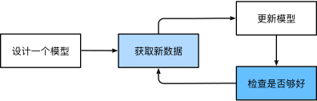

# 机器学习 Machine Learning
## 机器学习简介
机器学习（machine learning，ML）是一类强大的可以从经验中学习的技术。 通常采用观测数据或与环境交互的形式，机器学习算法会积累更多的经验，其性能也会逐步提高。

在机器学习中，*学习*（learning）是一个训练模型的过程。通过这个过程，我们可以发现正确的参数集，从而使模型强制执行所需的行为。 换句话说，我们用数据*训练*（train）模型。 如图所示，训练过程通常包含如下步骤：

1. 从一个随机初始化参数的模型开始，这个模型基本没有“智能”；
2. 获取一些数据样本（例如，音频片段以及对应的是或否标签）；
3. 调整参数，使模型在这些样本中表现得更好；
4. 重复第（2）步和第（3）步，直到模型在任务中的表现令人满意。

## 机器学习中的关键组件
首先介绍一些核心组件。无论什么类型的机器学习问题，都会遇到这些组件：
1. 可以用来学习的*数据*（data）；
2. 如何转换数据的*模型*（model）；
3. 一个*目标函数*（objective function），用来量化模型的有效性；
4. 调整模型参数以优化目标函数的*算法*（algorithm）。
### 数据 data
毋庸置疑，如果没有数据，那么数据科学毫无用武之地。许多经典机器学习方法假设样本近似独立同分布，但实际数据经常存在时间相关性、空间相关性、群组结构或分布漂移。 样本有时也叫做数据点（data point）或者数据实例（data instance），通常每个样本由一组称为特征（features，或协变量（covariates））的属性组成。 机器学习模型会根据这些属性进行预测。 在上面的监督学习问题中，要预测的是一个特殊的属性，它被称为标签（label，或目标（target））。

当每个样本的特征类别数量都是相同的时候，其特征向量是固定长度的，这个长度被称为数据的维数（dimensionality）。 固定长度的特征向量是一个方便的属性，它可以用来量化学习大量样本。然而，并不是所有的数据都可以用“固定长度”的向量表示。 以图像数据为例，如果它们全部来自标准显微镜设备，那么“固定长度”是可取的； 但是如果图像数据来自互联网，它们很难具有相同的分辨率或形状。 这时，将图像裁剪成标准尺寸是一种方法，但这种办法很局限，有丢失信息的风险。 此外，文本数据更不符合“固定长度”的要求。比如，对于亚马逊等电子商务网站上的客户评论，有些文本数据很简短（比如“好极了”），有些则长篇大论。 与传统机器学习方法相比，深度学习的一个主要优势是可以处理不同长度的数据。

一般来说，拥有越多数据的时候，工作就越容易。 更多的数据可以被用来训练出更强大的模型，从而减少对预先设想假设的依赖。请注意，仅仅拥有海量的数据是不够的，我们还需要正确的数据。 如果数据中充满了错误，或者如果数据的特征不能预测任务目标，那么模型很可能无效。 
### 模型 model
大多数机器学习会涉及到数据的转换。深度学习与经典方法的区别主要在于：前者关注的功能强大的模型，这些模型由神经网络错综复杂的交织在一起，包含层层数据转换，因此被称为深度学习（deep learning）。
### 目标函数 objective function
这里所说的“学习”，是指自主提高模型完成某些任务的效能。 但是，什么才算真正的提高呢？ 在机器学习中，我们需要定义模型的优劣程度的度量，这个度量在大多数情况是“可优化”的，这被称之为目标函数（objective function）。 我们通常定义一个目标函数，并希望优化它到最低点。 因为越低越好，所以这些函数有时被称为损失函数（loss function，或cost function）。 

通常，损失函数是根据模型参数定义的，并取决于数据集。 在一个数据集上，我们可以通过最小化总损失来学习模型参数的最佳值。 该数据集由一些为训练而收集的样本组成，称为训练数据集（training dataset，或称为训练集（training set））。 然而，在训练数据上表现良好的模型，并不一定在“新数据集”上有同样的性能，这里的“新数据集”通常称为测试数据集（test dataset，或称为测试集（test set））。

综上所述，可用数据集通常可以分成两部分：训练数据集用于拟合模型参数，测试数据集用于评估拟合的模型。 然后我们观察模型在这两部分数据集的性能。 “一个模型在训练数据集上的性能”可以被想象成“一个学生在模拟考试中的分数”。 这个分数用来为一些真正的期末考试做参考，即使成绩令人鼓舞，也不能保证期末考试成功。 换言之，测试性能可能会显著偏离训练性能。 当一个模型在训练集上表现良好，但不能推广到测试集时，这个模型被称为过拟合（overfitting）的。 就像在现实生活中，尽管模拟考试考得很好，真正的考试不一定百发百中。
### 优化算法 algorithm
当我们获得了一些数据源及其表示、一个模型和一个合适的损失函数，接下来就需要一种算法，它能够搜索出最佳参数，以最小化损失函数。 深度学习中，大多流行的优化算法通常基于一种基本方法–梯度下降（gradient descent）。 简而言之，在每个步骤中，梯度下降法都会检查每个参数，看看如果仅对该参数进行少量变动，训练集损失会朝哪个方向移动。 然后，它在可以减少损失的方向上优化参数。

## 监督学习
监督学习（supervised learning）擅长在“给定输入特征”的情况下预测标签。 每个“特征-标签”对都称为一个样本（example）。 有时，即使标签是未知的，样本也可以指代输入特征。 我们的目标是生成一个模型，能够将任何输入特征映射到标签（即预测）。

监督学习的学习过程一般可以分为三大步骤：
1. 从已知大量数据样本中随机选取一个子集，为每个样本获取真实标签。有时，这些样本已有标签（例如，患者是否在下一年内康复？）；有时，这些样本可能需要被人工标记（例如，图像分类）。这些输入和相应的标签一起构成了训练数据集；
2. 选择有监督的学习算法，它将训练数据集作为输入，并输出一个“已完成学习的模型”；
3. 将之前没有见过的样本特征放到这个“已完成学习的模型”中，使用模型的输出作为相应标签的预测。

综上所述，即使使用简单的描述给定输入特征的预测标签，监督学习也可以采取多种形式的模型，并且需要大量不同的建模决策，这取决于输入和输出的类型、大小和数量。 例如，我们使用不同的模型来处理“任意长度的序列”或“固定长度的序列”。

常见的监督学习问题有：
* 回归问题
* 分类问题
* 标记问题
* 搜索问题
* 推荐系统
* 序列学习

## 无监督学习
无监督学习（unsupervised learning）擅长让模型“自发”地去学习，通常给予模型的数据中不含“目标”，无监督学习使用没有人工标签的数据，学习数据中的结构、分布或表示。具体目标取决于任务，例如聚类、降维、密度估计和异常检测。

常见的无监督学习问题有：
* 聚类(K-Means算法)
* 降维
* 关联规则
* 异常检测

##  深度学习 Deep Learning
[**Deep Learning**](./DeepLearning.md)

## 损失函数（Loss Functions）

损失函数用于衡量模型预测与真实目标之间的差异。下面按照任务类型分类，并对每一种损失同时说明适用场景、作用和公式。除特别说明外，公式中的损失通常表示对一个样本或一个批次取平均后的结果。

### 回归损失

用于衡量预测连续值与真实值之间的差异。设 $y_i$ 为真实值，$\hat y_i$ 为预测值，$N$ 为参与计算的标量元素数量。

#### 均方误差损失（MSE Loss）

作用：对误差进行平方，大误差受到更强的惩罚。

$$
L_{\mathrm{MSE}}=\frac{1}{N}\sum_{i=1}^{N}(\hat y_i-y_i)^2
$$

#### 平均绝对误差损失（MAE / L1 Loss）

作用：衡量误差的绝对值，相比平方误差对极端误差更不敏感。

$$
L_{\mathrm{MAE}}=\frac{1}{N}\sum_{i=1}^{N}|\hat y_i-y_i|
$$

#### Huber 损失（Huber Loss）

作用：在小误差区域使用平方损失，在大误差区域使用绝对值损失，从而兼顾平滑性和鲁棒性。设 $e_i=\hat y_i-y_i$，$\delta>0$ 为阈值。

$$
L_{\mathrm{Huber}}(e_i)=
\begin{cases}
\frac{1}{2}e_i^2, & |e_i|\leq\delta\\
\delta\left(|e_i|-\frac{1}{2}\delta\right), & |e_i|>\delta
\end{cases}
$$

#### 平滑 L1 损失（Smooth L1 Loss）

作用：Huber 损失的一个常用变体，在误差较小时采用平方形式，在误差较大时采用线性形式，常用于目标检测等任务。

$$
L_{\mathrm{SmoothL1}}(e_i)=
\begin{cases}
\frac{1}{2}e_i^2/\beta, & |e_i|<\beta\\
|e_i|-\frac{1}{2}\beta, & |e_i|\geq\beta
\end{cases}
$$

其中 $\beta>0$ 为平滑阈值。

### 分类损失

用于衡量模型预测的类别概率与真实标签之间的差异。二分类和多标签分类通常对每个标签独立使用 Sigmoid；单标签多分类通常使用 Softmax，类别概率之和为 1。

#### 二元交叉熵损失（Binary Cross Entropy, BCE）

作用：用于二分类，或用于输出取值在 $[0,1]$ 范围内的重构任务。设真实标签 $y\in\{0,1\}$，预测概率为 $p\in(0,1)$。

$$
L_{\mathrm{BCE}}=-\left[y\log p+(1-y)\log(1-p)\right]
$$

#### 带 Logits 的二元交叉熵损失（BCEWithLogits Loss）

作用：将 Sigmoid 和 BCE 合并计算，避免先计算 Sigmoid 再计算对数带来的数值不稳定。设模型输出的 logit 为 $z$，$\sigma(z)=1/(1+e^{-z})$。

$$
L_{\mathrm{BCEWithLogits}}=-\left[y\log\sigma(z)+(1-y)\log\left(1-\sigma(z)\right)\right]
$$

#### 多分类交叉熵损失（Cross Entropy Loss）

作用：用于类别互斥的多分类任务，即每个样本只能属于一个类别。设真实类别为 $y$，模型对类别 $k$ 输出的概率为 $p_k$。

$$
L_{\mathrm{CE}}=-\log p_y
$$

若模型输出的是 logits $z_k$，则

$$
p_k=\frac{e^{z_k}}{\sum_{j=1}^{C}e^{z_j}}
$$

#### 负对数似然损失（Negative Log-Likelihood Loss, NLL Loss）

作用：用于已转换为对数概率的多分类输出，通常与 LogSoftmax 配合使用。设真实类别为 $y$，其对数概率为 $\log p_y$。

$$
L_{\mathrm{NLL}}=-\log p_y
$$

#### 多标签二元交叉熵损失（Multi-label BCE）

作用：用于一个样本可以同时属于多个类别的多标签分类任务。设第 $k$ 个标签为 $y_k\in\{0,1\}$，预测概率为 $p_k$。

$$
L_{\mathrm{Multi-label\ BCE}}=-\frac{1}{C}\sum_{k=1}^{C}\left[y_k\log p_k+(1-y_k)\log(1-p_k)\right]
$$

#### 多间隔损失（Multi-margin Loss）

作用：用于多分类间隔学习，使正确类别的得分至少比错误类别高出一定间隔。设真实类别为 $y$，类别得分为 $x_j$，间隔为 1，类别数为 $C$，则一种常见形式为

$$
L_{\mathrm{multi-margin}}=\frac{1}{C}\sum_{j\neq y}\max\left(0,1-x_y+x_j\right)^p
$$

其中 $p$ 通常取 1 或 2。

### 排序与度量学习损失

用于学习样本之间的相对顺序、相似性或距离关系。

#### 间隔排序损失（Margin Ranking Loss）

作用：要求正样本的得分高于负样本，并至少满足给定间隔。设目标 $y\in\{-1,1\}$，两个样本得分为 $x_1,x_2$，间隔为 $m$。

$$
L=\max\left(0,-y(x_1-x_2)+m\right)
$$

#### 铰链嵌入损失（Hinge Embedding Loss）

作用：用于相似性学习，使相似样本的距离变小，使不相似样本的距离至少大于给定间隔。设样本距离为 $x$，标签 $y\in\{1,-1\}$，间隔为 $m$。

$$
L=\begin{cases}
x, & y=1\\
\max(0,m-x), & y=-1
\end{cases}
$$

#### 余弦嵌入损失（Cosine Embedding Loss）

作用：根据标签拉近或推远两个向量的余弦相似度。设余弦相似度为 $s$，标签 $y\in\{1,-1\}$，间隔为 $m$。

$$
L=\begin{cases}
1-s, & y=1\\
\max(0,s-m), & y=-1
\end{cases}
$$

### 序列建模损失

#### 连接时序分类损失（Connectionist Temporal Classification, CTC Loss）

作用：用于输入序列和目标序列长度不同、且没有明确逐时间步对齐关系的任务，例如语音识别和 OCR。其基本形式是对所有能够通过折叠操作得到目标序列的路径概率求和，再取负对数：

$$
L_{\mathrm{CTC}}=-\log\sum_{\pi\in\mathcal{B}^{-1}(y)}P(\pi\mid x)
$$

其中 $x$ 为输入序列，$y$ 为目标序列，$\pi$ 为路径，$\mathcal{B}$ 为 CTC 折叠函数。

### 概率分布建模损失

#### KL 散度损失（KL Divergence）

作用：衡量两个概率分布之间的差异。KL 散度不是严格意义上的距离，通常不具有对称性。对于离散分布 $P$ 和 $Q$：

$$
D_{\mathrm{KL}}(P\Vert Q)=\sum_x P(x)\log\frac{P(x)}{Q(x)}
$$

#### 泊松分布负对数似然损失（Poisson NLL Loss）

作用：适用于目标为计数值、且可以近似服从泊松分布的回归任务。设目标为 $y$，泊松分布参数为 $\lambda>0$。

$$
L_{\mathrm{Poisson}}=\lambda-y\log\lambda+\log(y!)
$$

#### 高斯分布负对数似然损失（Gaussian NLL Loss）

作用：假设目标服从高斯分布，同时建模预测均值和方差。设均值为 $\mu$，方差为 $\sigma^2>0$。

$$
L_{\mathrm{Gaussian}}=\frac{1}{2}\left[\log(2\pi\sigma^2)+\frac{(y-\mu)^2}{\sigma^2}\right]
$$
