# 世界模型
给定动作，预测接下来会看到什么。

## 隐变量 latent
* 隐变量(latent)：没有被直接观测到、需要模型推断出来的“隐藏因素”，即进行模态编码器后的表征。
* 隐空间(latent space)：所有 latent 表示所在的低维向量空间，是模型“压缩世界”的地方，也能被称为*表征空间*。
* 隐状态(latent state)：某个时间点上，世界在隐空间里的一个具体表示。

latent 是“隐藏因素”，隐空间是这些因素的取值空间，隐状态是当前时刻在这个空间里的具体坐标。

## 三个模块
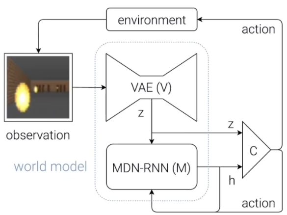

* V(ision)：观测
* M(emory)：记录和预测
* C(ontroller)：决策

VAE将一帧64x64的图片压成32个数的隐变量latent；MDN-RNN用(z, a, h)预测下一个z的分布；C是线性层，输入(z, h),输出动作。

整个模型的训练目标是*z*，能够将这一帧的画面重建回来。*h*是Memory的隐状态，带有时间维度的记忆。

世界模型不看分数，只有C看分数。
1. 随即乱开10_000局，记录画面和动作
2. 训练V，画面-> *z* -> 重建画面
3. 训练M，(z, a, h) -> 下一个 *z*
4. CMA-ES进化C，只看每局总分，不用梯度

把C放入M生存的梦里训练，再搬回真实游戏。将动作决策在虚拟环境中进行学习，学习完成后直接在真实环境中开始演化。但是C会钻M的漏洞**梦里满分，真实里崩**，这是因为世界模型是一个近似的模型，采样温度 $ \tau $ 越低，梦里就越稠密，同时C就越容易漏洞；采样温度 $ \tau $ 越高，梦里就越随机，模型就会失真偏离真实世界导致C不适合真实部署。

| 采样温度$ \tau $ | 梦里分数 | 真实分数 |
| --- | --- | --- |
| 0.10 | 2086 | **193** |
| 1.00 | 1145 | 868 |
| 1.15 | 918 | **1092** |
| 1.30 | 732 | 753 |
| 随机策略 | - | 210 |

## PlaNet
确定性的h记历史，随机的s表达多种未来。

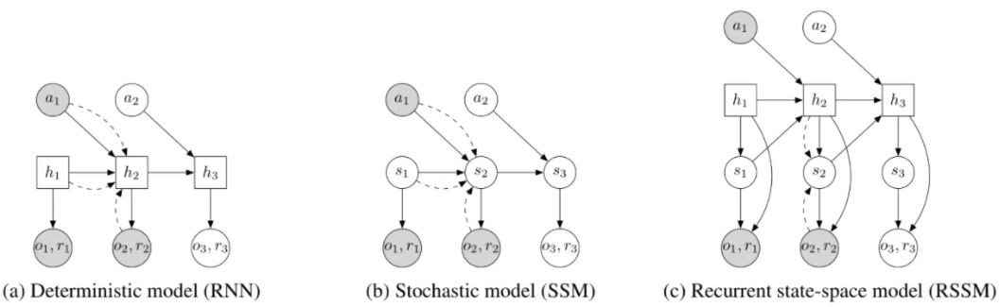

主要贡献：
* V和M合成一个模型训练。加入reward head，可以从状态预测统计分数，隐空间latent space必须保留对下一步预测有用的信息。但代价就是**世界模型绑定了任务**。
* 循循环状态空间模型。记录每个状态信息，处理序列。

纯GRU几乎不学，纯随机SSM学得慢。GRU只能输出一个未来，规划器会钻漏洞，每步都需要重新采集，模型记不住。

## Dreamer
在想象里训练actor-critic，不再每步规划。在训练循环中，策略钻到那里，下一轮真实数据就修哪里。*Dreamer V2*和*Dreamer V3*只是结构上进行改变。
### Dreamer V1
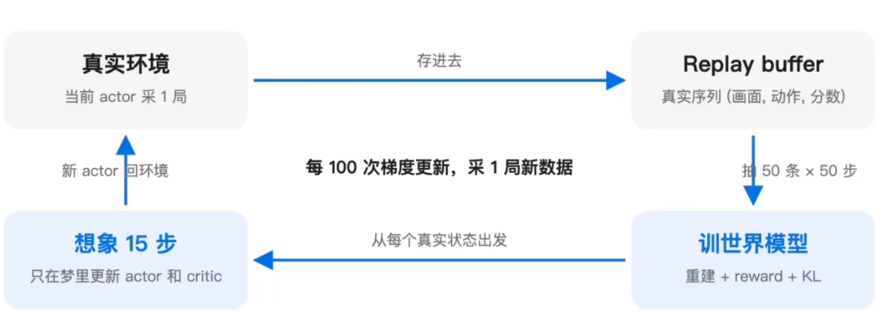

World Models，数据只采集一次，V->M->C串行训练；Dreamer V1，三块一起循环训练，钻漏洞的那一局本身就是模型最缺失的数据。
### Dreamer V2
隐空间latent space从高斯改成32个categorical x 32类（高斯连续变离散）。
### Dreamer V3
提出超参数优化，同一套超参数适用于8个领域 150+个任务中。最重要的结论：世界模型的性能来自于无监督的重建损失，去掉reward，去掉value的梯度，几乎不降低世界模型的性能，世界模型的表征并不是靠具体某一个任务学出来的。**世界模型重要的是世界而不是任务**。
### DayDreamer
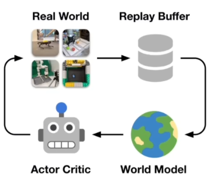

在真实世界中采集数据，使用learner和actor两个进程，靠replay和cheakpoint通信。

learner进程：训世界模型 + actor-critic，每20s存一版actor

actor进程：读传感器 -> 输出动作 -> 写replay，20Hz

真实世界负责*动*，将虚拟世界中输出的动作执行，只负责记录动作空间日志log（由传感器采集的数据得到），不进行任何学习；虚拟世界负责*学*，读取动作空间日志log的数据，抽取其中几段数据（dropout），去训练网络去回答下一瞬间世界会发生什么，机器人能得到多少分，修改动作策略，定期发送给真实世界中的机器人。

### 与仿真器的区别
对于*Mujuco*、*Isaac Sim*这类手写仿真器，与真实世界总会存在偏差，模拟出的环境无法代替真实环境。例如，电机的力矩曲线，机器人与地板的摩擦系数，绳子的软硬，相机画面的光照。而世界模型是使用真实的数据来拟合的，不需要知道电机的力矩曲线，机器人与地板的摩擦系数，绳子的软硬，这些内容都包含在*真实的数据*中，在世界模型中即在隐空间中，不需要任何人知道它们的存在，它们是个隐式的数据知识。

## JEPA
Joint-Embedding predictive Architecture，联合嵌入 预测 框架。在表征空间里预测，不在像素空间中预测。
### LeCun立场文
* 2022-06

六模块结构+JEPA

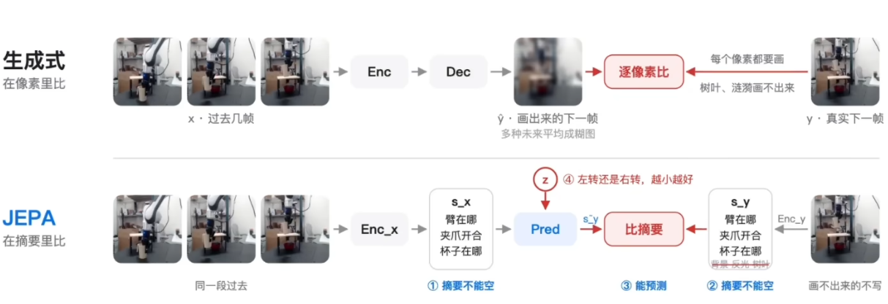

生成式 VS JEPA，生成式在像素空间中对未来进行预测，存在两个问题。第一，未来不唯一，因此图片会变得模糊；第二，真实世界中非重要像素也需要耗费算力，例如在自动驾驶中，道路绿化的树叶飘落是不需要进行预测的。

因此，LeCun确定一定要在隐空间中进行未来时刻的预测。*Encode_x*表示当前时刻的表征空间，*Encode_y*表示未来时刻的表征空间，*z*表示当前时刻想要预测未来时刻需要的隐空间的信息，然后比较当前时刻和未来时刻的表征空间进行损失计算，主要对**编码器**进行学习参数修改。但这种方式的代价就是必须防止坍缩，也就是*Encode_x*和*Encode_y*输出同一个参数变量，导致模型没有学习到任何东西。LeCun要求*s_x*和*s_y*不能为空，同时要求携带尽量多的信息，而*z*携带信息量尽可能少，不然的话，预测器可能作弊，将所有信息塞入*z*中，模型不再学习到从*s_x*中信息数据，无视*s_x*也能将误差降到零。

### I-JEPA
* 2023-01

图像，预测表征，不预测像素，图像版JEPA，看图的一块，预测另外四块的摘要。

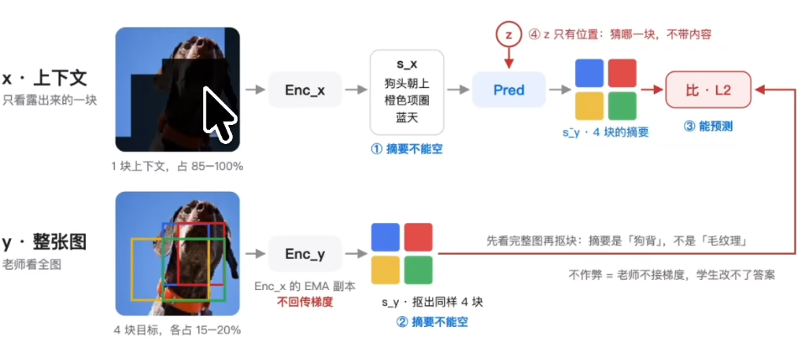

*x*是图片的露出来的一块，*y*是完整的图片。*z*相当于位置编码的作用，只有位置，猜哪一块，不带内容。通过对比学习，使用L2 Loss来得到Encode的参数。

### V-JEPA
* 2024-02

视频，挖掉90%的时空块，挖掉的块在时间上贯穿整段，其余照旧。

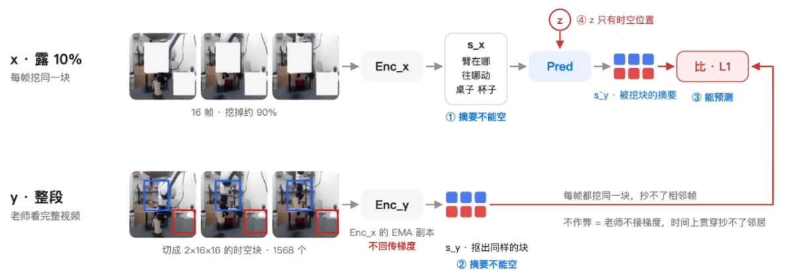

通过对比学习，使用L1 Loss来得到Encode的参数。

只看过去猜未来，表征反而更差。

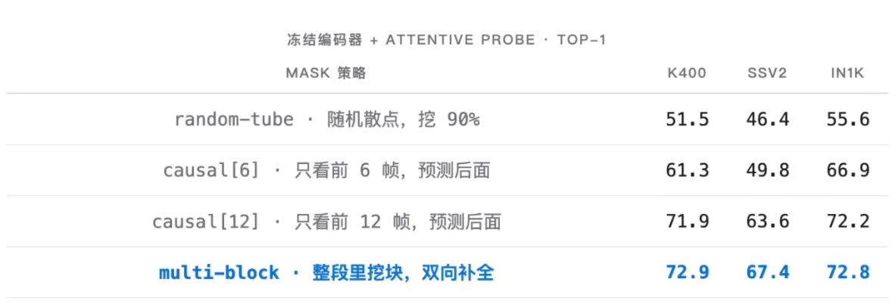

### DINO-WM
* 2024-11

冻结特征+小预测器，仿真器里规划，冻结编码器，z换成真实动作

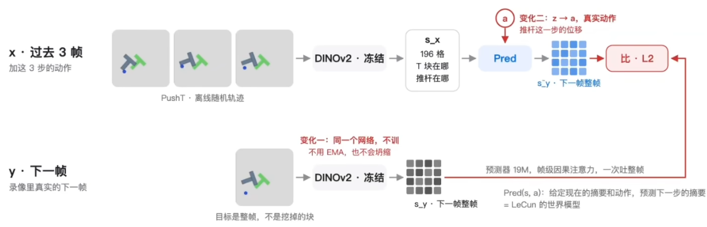

之前，JEPA的产物都是编码器，而*z*是固定的位置编码，它们都是表征空间里预测能不能学习更好的表征。而在DINO-WM中，第一次把JEPA思路变成一个能规划的世界模型。回答的是在表征空间中能来控制。

这里，冻结特征编码器，避免了坍缩的问题。然后将**预测条件**从类似位置编码*z*改用真实动作，实现了从表征预测模型到世界动作模型的转变。

### V-JEPA 2-AC
* 2025-06

100万小时视频预训练，真机零样本抓放。

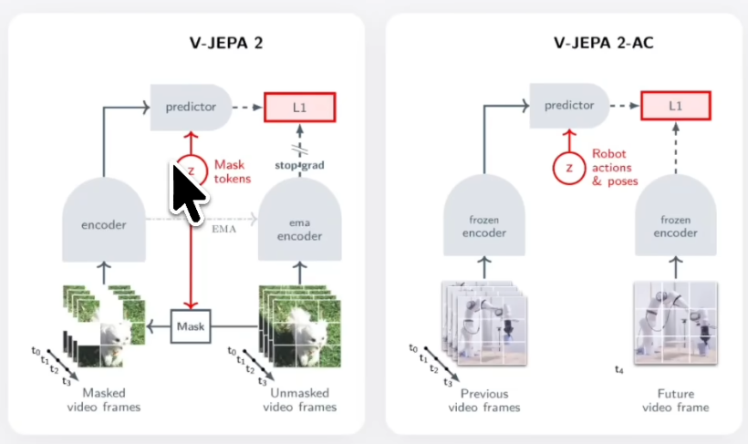

左边是V-JEPA的编码器，阶段一训，之后冻结。右边是V-JEPA 2-AC预测器，条件从mask位置换成动作和末端状态，阶段二训。

### JEPA的局限性
1. 对相机位置敏感：没有标定，动作坐标轴要从单目画面里猜
2. 长程规划不行：误差累计+搜索空间指数增长，抓放必须人给子目标图
3. 只支持图像目标：语言进不来

JEPA留下的东西：一个好用的编码器

### LeWorldModel
* 2026-03

从像素端到端训练

## Cosmos
### UniPi
*首帧 + 文本 -> 视频计划 -> 逆动力学模型 -> 动作*

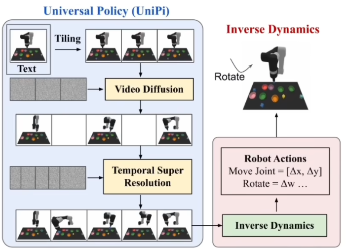

视频当统一的状态接口，文本当统一的任务接口。用视频描述周围环境，用文本描述当前任务。把决策拆成两段，与环境无关的命名为规划，直接生成一段视频；与本体相关的命名为控制，将视频内容控制机器人的动作（逆动力学）。

### Genie
相比于Dreamer世界模型，需要训练数据为视频+动作。Genie只用视频，学处逐帧可控的生成式环境。

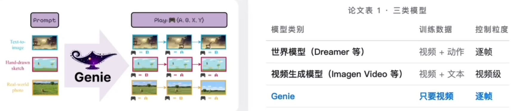

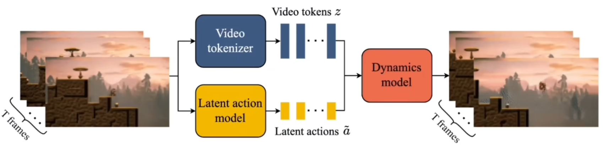

输入为图片，中间Video tokenizer和Latent action model，最后使用生成视频模型Dynamics Model来生成未来帧。其中Latent action model(LAM)有两个组件，LAM Encoder和LAM Decoder，LAM Encoder的输入为历史视频（包括当前帧），输出为隐空间的动作信息（只有一层32维的东西信息，非常小），LAM Decoder的输入为历史视频（没有当前帧）和隐空间的动作信息，输出为当前帧图片。

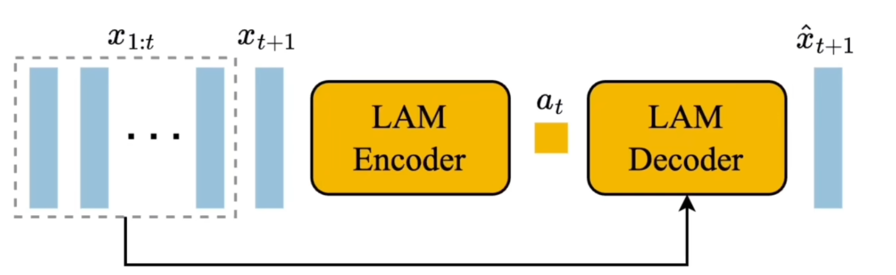

Genie之后，隐空间的动作信息成了无标注视频和机器人的接口。
### Cosmos1
世界基础模型平台。先预训练一个通才，再后训练成专才。

将原始视频（约2000万小时）进行切分（TransNetV2切镜头，2～60秒一段，使用GPU硬件转码）；再经过过滤运动、画质、字母、类型，去除最差15%的内容，以及100%过滤游戏、动画等不真实画面；然后使用VILA-13B写描述，8帧输入，平均97word；再使用InternVideo2嵌入K-means进行去掉重复内容；最后按照分辨率/宽高比/长度打包成webdataset，进行对应训练课程。

### Cosmos Policy
不改架构，视频模型*后训练*成策略、世界模型、价值函数。

把动作和alue伪装成latent帧，混进视频训列。动作块：归一化、拉平、复制填满，覆盖一个latent块。
三种训练方式:
1. 策略训练：给定历史图片，预测未来动作、下一帧图片、未来动作的价值函数；
2. 世界模型：给定历史图片，未来动作，预测下一帧图片、未来动作的价值函数；
3. 价值函数：给定历史图片，未来动作，下一帧图片，预测未来动作的价值函数；

### Cosmos3
一个权重，六种用法：
* 输入文本，图片，视频；输出文本
* 输入文本；输出图片
* 输入文本，图片，视频；输出视频，语音
* 输入文本，图片，视频；输出视频，动作
* 输入文本，图片，视频，动作；输出视频
* 输入文本，视频；输出动作

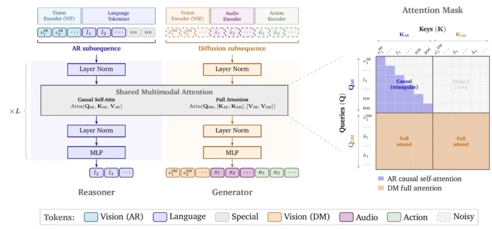

### Cosmos模态发展变化
从视频生成模型到世界模型，这一条线相比于VLA，精度更高但推理时间慢。

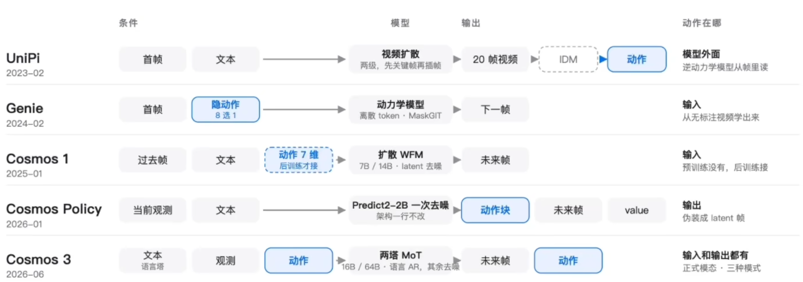

## World Action Model
视频模型不只是画出未来，它同时把动作一起生成出来。

| - | 世界模型 | VLA | 世界动作模型WAM |
| --- | --- | --- | --- |
|输入| 观测+动作 | 观测+指令 | 观测+指令 |
|输出| 未来观测 | 动作 | 未来观测+动作 |
|你能问他| “执行这个动作会怎么样” | “现在该怎么动” | “你打算怎么做” |
|代表模型| Dreamer、Cosmos | pi0.5、OpenVLA | DreamZero、Cosmos Policy |

