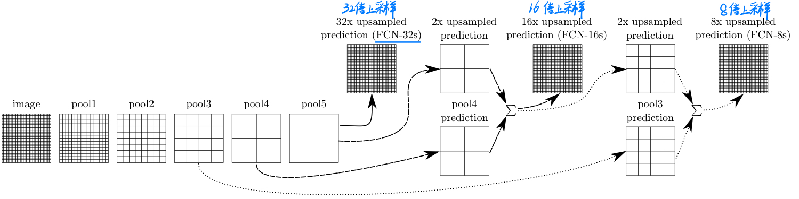

## 应用场景
### 图像分类
### 目标检测

### 语义分割

#### 语义分割数据集格式
* PASCAL VOC：PNG图篇，通常为调色板/索引颜色格式
* MS COCO：针对图像中的每一个目标都记录了多边形坐标
#### 语义分割评价指标
* Pixel Accuracy（Global Acc）：衡量全局的像素分类正确率，但可能受类别不平衡影响
* mean Accuracy：对每个类别的准确率取平均，更关注每个类别的性能
* **mean IoU**：衡量预测与真实标签之间的重叠程度，是语义分割中最常用的评价指标

#### 转置卷积 与 双线性插值
转置卷积不是卷积的逆运算，转置卷积也是卷积。它能将2x2矩阵变换成4x4矩阵。

转置卷积的运算步骤：
* 在输入特征图元素间填充`s-1`行，列`0`
* 在输入特征图四周填充`k-p-1`行，列`0`
* 将卷积核参数旋转180°翻转
* 做正常的卷积运算  
&nbsp;
torch.nn.ConvTranspose2d图像矩阵计算公式  
$H_{out} = (H_{in}-1) * stride[0] - 2 * padding[0] + dilation[0] * (kernel\_size[0] - 1) + output\_padding[0] + 1$
$W_{out} = (W_{in}-1) * stride[1] - 2 * padding[1] + dilation[1] * (kernel\_size[1] - 1) + output\_padding[1] + 1$
* H、W：图像尺寸
* stride：采样间隔
* padding：输入图像的填充
* output_padding：输出图像的填充
* kernel_size：卷积核大小
* dilation：膨胀卷积和空洞卷积
#### 膨胀卷积dilation convolution
在**保持原输入特征图尺寸**的同时，增大感受野。建议使用在深层网络中

#### 全卷积网络FCN
将最后的全连接层替换成卷积层，实现像素级预测。卷积层具有平移不变性，且无规定的输入大小。下采样能减少计算量，但会丢失细节。

因此，经过pool5后进行上采样的FCN-32s模型准确率并不高；经过pool3后进行上采样并与之前图像融合后的FCN-8s模型准确率最高。

#### LargeFOV
核心思想：通过空洞卷积扩大感受野，覆盖更广的图像区域。单层大范围上下文捕获。  

空洞卷积只有在选择合适 padding 时，才能保持输入输出空间尺寸一致。

将替换全连接的卷积层从`核大小7x7，步距4`降低为`核大小3x3，步距12`，它们具有相同的感受野，但降低后的训练参数变少，提升训练速度。

#### MSc(Multi-Scale)
核心思想：在不同分辨率或尺度下分析图像，捕捉不同层次的语义和细节信息。使用图像金字塔、特征自己他、空洞卷积多分支。多尺度特征融合。
#### MGc(Multi-Grid)
核心思想：在残差块中分层使用不同扩张率组合，扩大感受野的同时保持计算效率。分层扩大感受野。
#### CRF（Conditional Random Field，条件随机场）
核心思想：基于像素间空间关系优化分割结果，提升边界精度。优化分割边界。
#### ASPP模块

核心思想：并行多分支结构捕获多尺度上下文信息。并行多尺度上下文建模。  

ASPP模块用于多尺度特征提取的关键部分。ASPP应该包含多个并行的卷积层，每个卷积层有不同的膨胀率（dilation rate），这样可以捕获不同尺度的上下文信息。此外，还有一个全局平均池化层，用于捕捉图像级别的特征，最后将所有分支的特征拼接起来，再通过一个投影层得到最终的输出。 